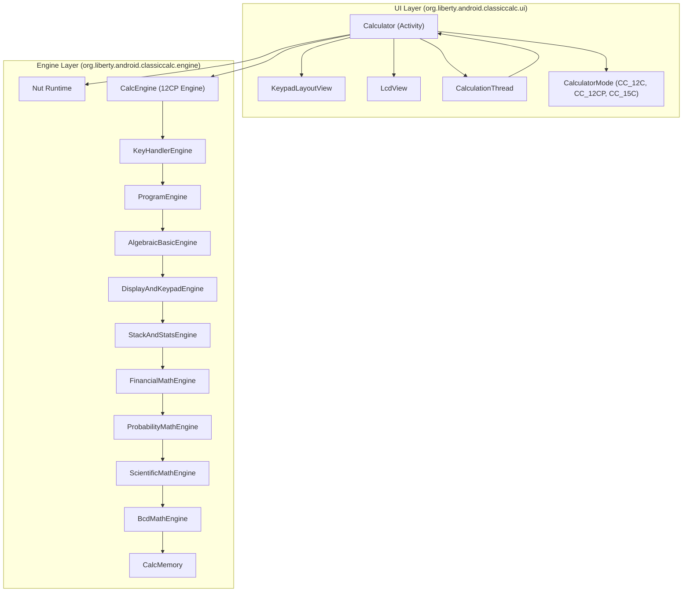

# Classic Calc Developer Guide (`DEV.md`)

This document describes the project layout, architecture, calculation engines, LCD/keypad protocol, build instructions, and JVM unit test suite for **Classic Calc** (`org.liberty.android.classiccalc`).

---

## 1. Project Structure

```text
classic_calc/
├── app/
│   ├── build.gradle                         # Android application & test configuration
│   └── src/
│       ├── main/
│       │   ├── AndroidManifest.xml          # Main activity & mode-specific launcher activity aliases
│       │   ├── assets/
│       │   │   └── fonts/calc_font.ttf      # Custom 7-segment LCD typeface
│       │   ├── res/
│       │   │   ├── drawable*/               # Keypad, button, back-cover, and icon bitmaps
│       │   │   ├── layout/                  # Portrait/landscape calculator, settings, and back-cover XMLs
│       │   │   ├── raw/keypress.wav         # Key click audio asset
│       │   │   └── values*/                 # Strings, dimensions, and styles
│       │   └── java/org/liberty/android/classiccalc/
│       │       ├── ui/                      # Android UI layer, touch mapping, threading, and LCD view
│       │       └── engine/                  # Calculator engines
│       └── test/
│           └── java/org/liberty/android/classiccalc/
│               └── engine/                  # Local JVM JUnit 4 test suite
├── build.gradle                             # Top-level Gradle build file
├── settings.gradle                          # Gradle project settings
├── README.md                                # User-facing overview and features
└── DEV.md                                   # Developer documentation (this file)
```

---

## 2. Architecture Overview

The codebase is divided into two cleanly separated packages with **zero native (`.so`/JNI) dependencies**:



---

## 3. UI Layer (`org.liberty.android.classiccalc.ui`)

| Class | Responsibility |
| :--- | :--- |
| [`Calculator.java`](file:///home/liberty/mp/android/classic_calc/app/src/main/java/org/liberty/android/classiccalc/ui/Calculator.java) | Main `Activity`. Manages lifecycle, active [`CalculatorMode`](file:///home/liberty/mp/android/classic_calc/app/src/main/java/org/liberty/android/classiccalc/ui/CalculatorMode.java), Settings dialog, Quick Guide dialog, audio/haptic feedback, idle wake-lock timeout, launcher alias switching, and bridges between UI and engine instances (`emulator12C`, `engine12CP`, `emulator15C`). |
| [`CalculatorMode.java`](file:///home/liberty/mp/android/classic_calc/app/src/main/java/org/liberty/android/classiccalc/ui/CalculatorMode.java) | Enum defining the three calculator modes (`CC_12C`, `CC_12CP`, `CC_15C`), their display names, launcher `activity-alias` class names, and portrait/landscape background drawables. |
| [`KeypadLayoutView.java`](file:///home/liberty/mp/android/classic_calc/app/src/main/java/org/liberty/android/classiccalc/ui/KeypadLayoutView.java) | Custom `AbsoluteLayout` that scales the calculator faceplate, maps touch coordinates to key bounding boxes (`KeyButtonInfo`), renders pressed-key overlays, and dispatches key-down/key-up events. |
| [`CalculationThread.java`](file:///home/liberty/mp/android/classic_calc/app/src/main/java/org/liberty/android/classiccalc/ui/CalculationThread.java) | Background worker thread maintaining a 16-entry circular key buffer (`keyBuffer`) and executing calculator cycles off the Android UI thread. |
| [`LcdView.java`](file:///home/liberty/mp/android/classic_calc/app/src/main/java/org/liberty/android/classiccalc/ui/LcdView.java) | Custom `View` that parses the engine's display string (`digits + 11 indicator characters`) and renders the 10-digit 7-segment display, decimal points/commas, and status annunciators (`-`, `RPN`, `ALG`, `f`, `g`, `BEGIN`, `D.MY`, `C`, `PRGM`, etc.). |

---

## 4. Engine Layer (`org.liberty.android.classiccalc.engine`)

Classic Calc uses two distinct pure-Java calculation engines:

### 4.1 `NutEngine`
- **File**: [`NutEmulator.java`](file:///home/liberty/mp/android/classic_calc/app/src/main/java/org/liberty/android/classiccalc/engine/NutEmulator.java)
- **Design**: Cycle-accurate emulator for the HP Nut CPU architecture paired with embedded ROM images (`NutRomData12c` and `NutRomData15c`).
- **State Layout**: Stores CPU registers ($A, B, C, M, N, G$, $P, Q$, $F, S$, carry, program counter, call stack, RAM registers, and LCD segment bits) inside a 2,048-byte little-endian `ByteBuffer` (`g_calc`) persisted to disk (`state` for 12C, `state15c` for 15C).
- **Key & Execution Cycle**:
  - `keyPressed(int keyCode, boolean isKeyUp)` updates the active key matrix state (`System_`) and queues key-down events into `s_key_buf`.
  - `executeCalc()` runs `execute()` until the ROM reaches sleep/display refresh, decodes the 7-segment LCD bitmaps (`LcdData`) via `convertNumberToString()`, notifies `Callback.updateLcd(String)`, and returns `g_ResultStub + g_StatusIndicators`.

### 4.2 `CalcEngine` Hierarchy (CC 12C Platinum)
The CC 12C Platinum engine is structured as a linear inheritance chain of 11 specialized classes:

1. [`CalcMemory.java`](file:///home/liberty/mp/android/classic_calc/app/src/main/java/org/liberty/android/classiccalc/engine/CalcMemory.java):
   - Manages a 2 MB little-endian `ByteBuffer` (`mem`) modeling `.rodata` (`0x0b77e0`), `.data` (`0x11e9a8`), `.bss` (`0x120000`), string pool (`0x160000`), and stack (`0x1f0000`).
   - Defines `CC_Real` (128-bit unpacked BCD floating-point value: `s` sign/status, `e` exponent, `m` 64-bit 16-nibble BCD mantissa) and named `.rodata` mathematical constants (`CC_0`, `CC_1`, `CC_PI`, `CC_100`, etc.).
   - Implements state file serialization (`readStateFile` / `writeStateFile`) to `/data/data/org.liberty.android.classiccalc/p`.
2. [`BcdMathEngine.java`](file:///home/liberty/mp/android/classic_calc/app/src/main/java/org/liberty/android/classiccalc/engine/BcdMathEngine.java):
   - Core BCD nibble arithmetic (`dcbAddAdjust`, `dcbSubAdjust`, `dcbMul`, `dcbShiftRound`, `bintobcd`, `dcbtobin`).
   - Floating-point operations: `fadd`, `fradd`, `firadd`, `fmul`, `fdiv`, `fisqrt`, `_fmod`, `fPack`/`fUnpack`, rounding/truncation (`firnd`, `fitrunc`, `fiIP`, `fiFP`, `fifloor`, `ficeil`), comparisons (`fLT`, `fLE`, `fEQ`, `fNE`, `fZero`), and string conversions (`fStringToCC_er`, `fCCToString`).
3. [`ScientificMathEngine.java`](file:///home/liberty/mp/android/classic_calc/app/src/main/java/org/liberty/android/classiccalc/engine/ScientificMathEngine.java):
   - Factorials (`fifact_L`), permutations/combinations (`fipermComb_L`), trigonometry (`fitrig`, `fiatrig`), hyperbolics (`fisincosh`, `fitanh`, `fiasinh`, `fiacosh`, `fiatanh`), logarithms and exponentials (`filn`, `flnp1`, `filog`, `fiexpm`), and powers/roots (`fpow`, `finthroot`).
4. [`ProbabilityMathEngine.java`](file:///home/liberty/mp/android/classic_calc/app/src/main/java/org/liberty/android/classiccalc/engine/ProbabilityMathEngine.java):
   - Upper-tail normal distribution (`fiUTPN`), Student's $t$, $\chi^2$, and $F$-distribution cumulative probability functions.
5. [`FinancialMathEngine.java`](file:///home/liberty/mp/android/classic_calc/app/src/main/java/org/liberty/android/classiccalc/engine/FinancialMathEngine.java):
   - TVM solvers (`TVMN`, `TVMI`, `TVMPV`, `TVMPMT`, `TVMFV`, `TVMAMORT`), cash flow analysis (`CFLO_NPV`, `CFLO_IRR`), bond pricing/yield (`BondPrice`, `BondYield`), depreciation (`DepSL`, `DepSOYD`, `DepDB`), date calculations (`DateDDays`, `DateDate`, `DateLeap`), percentages (`PartAsPercentOfTotal`, `MarkupAsPercentOfCost`, `MarkupAsPercentOfSale`), and `BreakEven`.
6. [`StackAndStatsEngine.java`](file:///home/liberty/mp/android/classic_calc/app/src/main/java/org/liberty/android/classiccalc/engine/StackAndStatsEngine.java):
   - RPN/ALG stack manipulation (`Stack_GetX`, `Stack_SetX`, `Stack_InsertToX`, `Stack_SwapXY`, `Stack_RotateDownOneStep`), storage registers, cash flow list storage, and statistical accumulation/regression.
7. [`DisplayAndKeypadEngine.java`](file:///home/liberty/mp/android/classic_calc/app/src/main/java/org/liberty/android/classiccalc/engine/DisplayAndKeypadEngine.java):
   - Virtual LCD character buffer (`g_ResultStub`) and 11-byte annunciator array (`g_StatusIndicators`), keypad shift translation (`Com_KeypadTranslate` for `f`/`g` prefixes), state machine checks (`ComKeyCheckState`), and `sysMainLoop`.
8. [`AlgebraicBasicEngine.java`](file:///home/liberty/mp/android/classic_calc/app/src/main/java/org/liberty/android/classiccalc/engine/AlgebraicBasicEngine.java):
   - Digit entry buffer (`g_basic_edit`), `STO`/`RCL`/`GTO` multi-key sequences (`Basic_StoProcess`, `Basic_RclProcess`), and Algebraic/RPN expression evaluation.
9. [`ProgramEngine.java`](file:///home/liberty/mp/android/classic_calc/app/src/main/java/org/liberty/android/classiccalc/engine/ProgramEngine.java):
   - Keystroke program memory, step encoding/decoding, single-step/back-step (`SST`/`BST`), and program execution loop (`Prog_Exec`).
10. [`KeyHandlerEngine.java`](file:///home/liberty/mp/android/classic_calc/app/src/main/java/org/liberty/android/classiccalc/engine/KeyHandlerEngine.java):
    - Top-level key-down and key-up handlers (`Base_HandleKeyDown`, `Base_HandleKeyUp`) for all calculator keys and shifted functions.
11. [`CalcEngine.java`](file:///home/liberty/mp/android/classic_calc/app/src/main/java/org/liberty/android/classiccalc/engine/CalcEngine.java):
    - Public synchronized entry point exposing `keyPressed(int key, byte isKeyUp)`, `resetCalc()`, `swapDecimalSep()`, `saveCalcData()`, and `restoreCalcData()`.

---

## 5. Display String Format

Both `NutEmulator.executeCalc()` and `CalcEngine.getResultPlusStatus()` return a combined string:

```text
<digits_portion><11_indicator_chars>
```

- **Last 11 characters** (`raw.substring(raw.length() - 11)`): Each character is `'0'` (off) or `'1'` (on):
  - **CC 12C / CC 15C (`NutEmulator`)**:
    `[0]="-"`, `[1]="*"`, `[2]="USER"`, `[3]="f"`, `[4]="g"`, `[5]="BEGIN"`, `[6]="G"`, `[7]="RAD"`, `[8]="D.MY"`, `[9]="C"`, `[10]="PRGM"`
  - **CC 12C Platinum (`CalcEngine`)**:
    `[0]="-"`, `[1]="|"`, `[2]="RPN"`, `[3]="ALG"`, `[4]="( )"`, `[5]="f"`, `[6]="g"`, `[7]="BEGIN"`, `[8]="D.MY"`, `[9]="C"`, `[10]="PRGM"`
- **Leading characters** (`raw.substring(0, raw.length() - 11)`): The formatted LCD digits, decimal point, and thousands separators. Note that the negative sign is represented by indicator `[0] == '1'`.

---

## 6. Building the App

Compile the debug APK using Gradle:

```bash
gradle --offline assembleDebug
```

The resulting APK is generated at:
`app/build/outputs/apk/debug/app-debug.apk`

---

## 7. Unit Tests

The engine has a fast, parallelized JUnit 4 local JVM unit test suite under `app/src/test/java/org/liberty/android/classiccalc/engine/` (39 tests, ~280 ms execution time):

| Test Class | Coverage |
| :--- | :--- |
| [`NutEmulatorTest.java`](file:///home/liberty/mp/android/classic_calc/app/src/test/java/org/liberty/android/classiccalc/engine/NutEmulatorTest.java) | **11 tests**: CC 12C & CC 15C reset, RPN arithmetic (`+`, `-`, `×`, `÷`), `CHS`/`EEX`/`CLx`, stack `x≷y`, `STO`/`RCL`, `f`/`g` shift annunciators, TVM loan payment solver, 15C scientific functions ($\sqrt{x}, y^x, 1/x, \sin, \cos, \tan$), decimal separator swap, and state file save/restore. |
| [`CalcMemoryAndBcdMathTest.java`](file:///home/liberty/mp/android/classic_calc/app/src/test/java/org/liberty/android/classiccalc/engine/CalcMemoryAndBcdMathTest.java) | **9 tests**: `CalcMemory` 8/16/32/64-bit signed/unsigned loads and stores, C string/memory helpers (`strlen`, `strcpy`, `memcpy`, `memset`, `atoi`, `inttostr_t`), `.rodata` constant verification (`CC_0`, `CC_1`, `CC_N1`, `CC_100`, `CC_PI`), BCD integer/u64/nibble conversions, string parsing/formatting, `fPack`/`fUnpack` round-trip, BCD arithmetic, rounding/truncation (`fiIP`, `fiFP`, `firnd`, `fitrunc`, `fifloor`, `ficeil`, `fichs2`, `fiabs2`), and comparisons (`fLT`, `fLE`, `fEQ`, `fNE`, `fZero`, `fimax`, `fimin`, `fiInteger`, `fiParity`). |
| [`ScientificAndFinancialMathTest.java`](file:///home/liberty/mp/android/classic_calc/app/src/test/java/org/liberty/android/classiccalc/engine/ScientificAndFinancialMathTest.java) | **8 tests**: Factorials (`fifact_L`), permutations & combinations (`fipermComb_L`), trigonometry & inverse trig (`fitrig`, `fiatrig`), hyperbolic & inverse hyperbolic functions (`fisincosh`, `fitanh`, `fiasinh`, `fiacosh`, `fiatanh`), logs/exponentials/powers/roots (`fiexpm`, `filn`, `filog`, `flnp1`, `fpow`, `finthroot`), normal distribution upper-tail probability (`fiUTPN`), TVM solvers (`TVMPMT`, `TVMPV`, `TVMN`, `TVMI`, `TVMFV`), percentages/markup/margin/break-even/leap-year, and RPN stack operations. |
| [`CalcEngineIntegrationTest.java`](file:///home/liberty/mp/android/classic_calc/app/src/test/java/org/liberty/android/classiccalc/engine/CalcEngineIntegrationTest.java) | **11 tests**: End-to-end CC 12CP keystroke simulation across RPN mode, scientific keys ($1/x, y^x, \sqrt{x}, x^2, n!$), percentage keys (`%`, `Δ%`, `%T`), Algebraic (`ALG`) mode with parentheses, `STO`/`RCL` storage register arithmetic (`STO +`, `STO ×`), TVM workflow, Cash Flow (`NPV` & `IRR`), statistics ($\Sigma+$, $\bar{x}$, $s$), date `ΔDYS`, keystroke program recording/execution, decimal separator swap, and state persistence. |

### Running the Unit Tests

```bash
gradle --offline testDebugUnitTest
```

HTML test reports are generated at:
`app/build/reports/tests/testDebugUnitTest/index.html`
